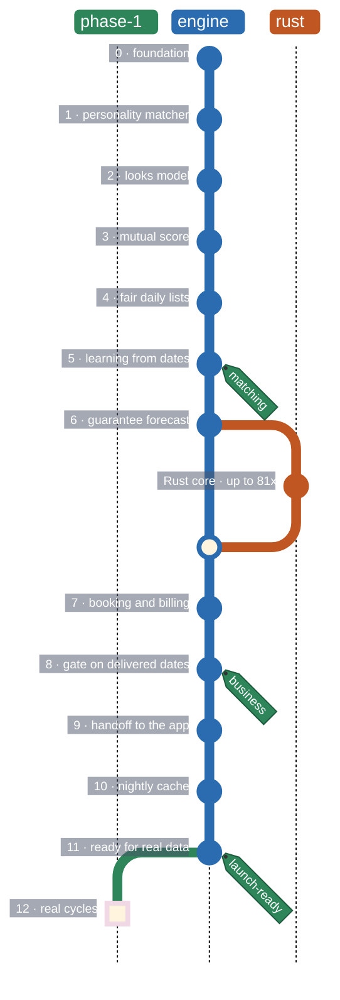

<h1 align="center">lastfirstdate-matching</h1>

<p align="center">
  The matching engine behind <a href="https://lastfirstdate.vercel.app/">lastfirstdate</a>:
  mutual, fair, and built around real dates.
</p>

<p align="center">
  <a href="https://github.com/currencycaver29/lastfirstdate-matching/actions/workflows/checks.yml"></a>
  
  
  
</p>

---

## About

lastfirstdate is a verified dating service for New York: women choose who they meet, and men
subscribe for three guaranteed dates a month. This repository is the algorithm behind it,
the part that decides who sees whom, when they meet and where. The app itself is built
separately.

After a short photo exercise, the engine learns what each member finds attractive. It then
ranks every possible match **50% on looks, as that member sees them, and 50% on personality
and interests**, and only puts forward matches that work for both people. Daily lists are
shared out fairly, so a few popular profiles don't take all the attention. Each profile comes
with a date window both people can make. Behind it all, the engine protects the guarantee: it
forecasts whether each man will get his dates, and pauses men's sign-ups when the market
can't serve more of them.

## How it works


Blue boxes are the matching stages a profile passes through every day. After each date, the
green boxes learn from what happened and the orange box keeps the promise of three dates a
month; all three shape the next day's lists.

<details>
<summary><b>What each stage does</b></summary>

<br/>

| # | Stage | What it does |
|:-:|---|---|
| 1 | **Filter** | Keeps only pairs who could actually meet: orientation both ways, age, distance, dealbreakers, verification |
| 2 | **Calibration** | Picks about 30 photos, singles and "who are you more drawn to?" pairs, that teach the model the most about a new member |
| 3 | **Looks taste** | Learns each member's personal photo taste as a small Bayesian model on top of a shared starting point |
| 4 | **Personality** | Scores free-text prompts, intent answers (timeline, exclusivity, kids) and interests |
| 5 | **Mutual score** | Mixes looks and personality 50/50 in each direction, then combines both directions so both people must want it |
| 6 | **Daily lists** | Builds each woman's daily list under an exposure cap, with a boost for men still owed dates |
| 7 | **Booking** | Proposes the earliest window both are free, holds it for 15 minutes while both $10 payments arrive, picks a venue fair to both |
| 8 | **Learning** | Learns from picks, dates and private ratings, and keeps exploring a little |
| – | **Trust** | Builds a private score from respectfulness, profile accuracy and showing up; lowers low-trust profiles and flags them for review |
| – | **Guarantee** | Forecasts each man's chance of three dates, admits men from the waitlist only while that holds, counts delivered dates and credits shortfalls |

</details>

## Results in simulation

All numbers come from synthetic members. They compare designs; they are not predictions.

| Question | Answer |
|---|---|
| How well does the looks model learn a member's taste? | AUC 0.844, against a ceiling of 0.875 |
| Do fair lists spread attention? | Exposure Gini falls from 0.39 to 0.31 |
| How many men get their 3 dates in the real booking flow? | About 82% with 300 women at 3 women per man; about 90% with 500 women |
| Does the ratio gate protect the promise? | Yes: with 300 women it admits only the few men it can serve, where admitting 3:1 would deliver about 75% |
| How much faster is the Rust core? | Looks taste 3.6×, daily lists 10×, the gate 28× to 81×, with identical results |

Each sprint's notes in [`docs/sprints/`](docs/sprints/) explain these results and their limits.

## Getting started

### Requirements

- Python 3.11 or newer
- Rust, from [rustup.rs](https://rustup.rs). Installing the package compiles the Rust core.

### Install

```bash
git clone https://github.com/currencycaver29/lastfirstdate-matching.git
cd lastfirstdate-matching
python -m venv .venv
.venv/bin/pip install -e ".[dev]"
```

On Windows, use `.venv\Scripts\pip` instead of `.venv/bin/pip`.

### Try it

```python
from lastfirstdate.config import load
from lastfirstdate.synthetic import generate
from lastfirstdate.simulate import run_month

cfg = load()                   # research defaults; load("config/phase1.toml") for Phase 1 rules
pop = generate(cfg, seed=7)    # 1,000 fake New Yorkers
report = run_month(pop, cfg)
print(report.text())
```

### Reports

Each report runs a simulation and prints what it found:

```bash
.venv/bin/python -m lastfirstdate.simulate          # one simulated month
.venv/bin/python -m lastfirstdate.looks_report      # how well the looks model learns taste
.venv/bin/python -m lastfirstdate.mutual_report     # list rankings compared
.venv/bin/python -m lastfirstdate.fairness_report   # exposure, fairness audit, hold-back test
.venv/bin/python -m lastfirstdate.learning_report   # three months with and without learning
.venv/bin/python -m lastfirstdate.phase1_report     # Phase 1 rules: pair questions, the ratio gate
.venv/bin/python -m lastfirstdate.cycle_sim         # the real booking flow over three billing cycles
.venv/bin/python -m lastfirstdate.gate_report       # the ratio gate in the real flow, two zone sizes
```

To refit the guarantee forecast after changing the settings, run
`python -m lastfirstdate.forecast_fit --delivered` (about 16 minutes).

### Checks

```bash
./scripts/check.sh
```

This runs Rust formatting, Clippy and tests, rebuilds the Rust module, then runs ruff, the
Python tests and a check that every requirement has a test. The same checks run on GitHub for
every push.

## Configuration

Every weight, cap and threshold lives in a settings file, never in code:

| File | Use |
|---|---|
| [`config/lastfirstdate.toml`](config/lastfirstdate.toml) | Research defaults: a 1,000-member city, every orientation |
| [`config/phase1.toml`](config/phase1.toml) | lastfirstdate's Phase 1: one NYC zone, 100 paying men and 300 women, a three-date cap, 30 calibration photos |

`LASTFIRSTDATE_BACKEND=python` runs everything in plain Python instead of Rust. The answers
are the same, only slower.

## Project structure

```
lastfirstdate-matching/
├── config/              settings files and the fitted forecast
├── db/schema.sql        the database the app should keep
├── docs/                specification, research, sprint notes, fit report, risk plan, handoff
├── rust/
│   ├── lastfirstdate-core/   the hot loops in pure Rust
│   └── lastfirstdate-py/     Python bindings (lastfirstdate._core)
├── src/lastfirstdate/   the engine (Python; app.py is what the app calls) and the simulator
├── tests/               one or more tests per requirement
├── workspace/           a map of every algorithm stage, for working with an AI assistant
└── scripts/check.sh     all the checks
```

## Principles

These rules are never broken, and tests enforce them:

1. **Mutual orientation lock.** Someone is shown to you only if each of you is a gender the
   other is looking for.
2. **No global attractiveness score.** Looks are only ever scored from one member's own point
   of view. Nothing ranks people by overall attractiveness.
3. **Synthetic data only** in this repository. In production, photo embeddings are treated as
   biometric data: encrypted, kept apart, deleted when a member leaves.
4. **Tests run offline,** with no model downloads.
5. **Every tunable number lives in the settings files.**
6. **Dealbreakers are hard filters,** never soft penalties.
7. **Same seed, same result.** All randomness is seeded.

## Documentation

| Document | What's in it |
|---|---|
| [Specification](docs/SPEC.md) | Every requirement, rule and decision, and how the plan changed |
| [Research map](docs/research.md) | The 17 papers and where each one is used |
| [Sprint notes](docs/sprints/) | In-depth study notes for every sprint, with results and limits |
| [Fit report](docs/fit-report.md) | The engine checked against lastfirstdate's website |
| [Risk plan](docs/risk-plan.md) | What to do before launch, including a ready-to-send lawyer briefing |
| [Handoff](docs/handoff/README.md) | For the app developer: which engine call happens when, what it reads and returns |
| [Workspace](workspace/CONTEXT.md) | A one-page map of each algorithm stage and how sprints are run (Interpretable Context Methodology), so an AI assistant reads only the part it works on |

## Roadmap

Built one sprint at a time. Every sprint ships with passing tests and a study note that explains
its math in plain words, so you can read the engine in the order it was built.



### What's inside each chapter

| Chapter | Sprints | Ideas you'll find |
|---|---|---|
| **Matching** | [0](docs/sprints/sprint-0.md) · [1](docs/sprints/sprint-1.md) · [2](docs/sprints/sprint-2.md) · [3](docs/sprints/sprint-3.md) · [4](docs/sprints/sprint-4.md) · [5](docs/sprints/sprint-5.md) | Active preference learning · a determinantal point process for a varied start · reciprocal scores joined by a harmonic mean · fairness of exposure · Nash social welfare · exploration from competing bandits |
| **Business** | [6](docs/sprints/sprint-6.md) · [Rust](docs/sprints/rust-core.md) · [7](docs/sprints/sprint-7.md) · [8](docs/sprints/sprint-8.md) | A logistic forecast of each man's dates · a ratio gate that pauses sales · a booking state machine with 15-minute payment holds · minimax venue choice · Bayesian trust · Rust twins through PyO3 |
| **Launch-ready** | [9](docs/sprints/sprint-9.md) · [10](docs/sprints/sprint-10.md) · [11](docs/sprints/sprint-11.md) | The engine on the app's database · a resumable photo exercise · an incremental nightly cache · Platt-scaling recalibration · a time-split switch rule |
| **Phase 1** | 12, next | Real cycles from one New York zone, recalibrated monthly |

### Open problems

What's left is tracked as issues. Each known limit is pinned by a strict expected-failure test,
so the day a change fixes one, the test suite says so.

| Label | What it holds |
|---|---|
| [launch-blocker](https://github.com/currencycaver29/lastfirstdate-matching/issues?q=is%3Aissue+is%3Aopen+label%3Alaunch-blocker) | The guarantee rate and the legal wording, settled before sales |
| [known-limit](https://github.com/currencycaver29/lastfirstdate-matching/issues?q=is%3Aissue+is%3Aopen+label%3Aknown-limit) | Measured limits in learning, forecasting and scale: good problems for an ML or systems developer |
| [needs-real-data](https://github.com/currencycaver29/lastfirstdate-matching/issues?q=is%3Aissue+is%3Aopen+label%3Aneeds-real-data) | Questions only Phase 1 can answer |

## License

No open-source license has been chosen yet. All rights are reserved by the owner.
