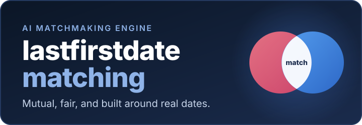
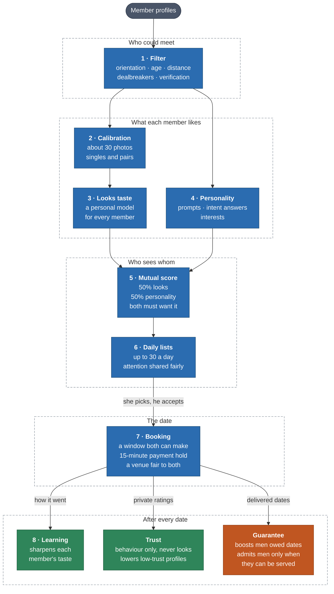
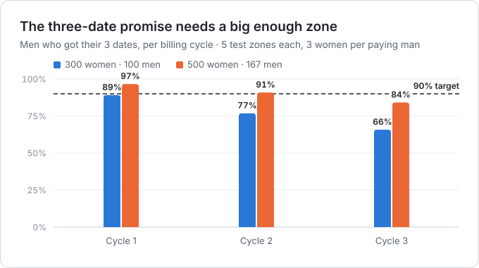
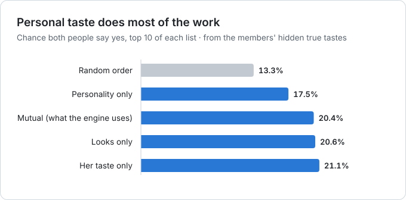
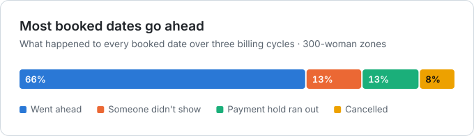
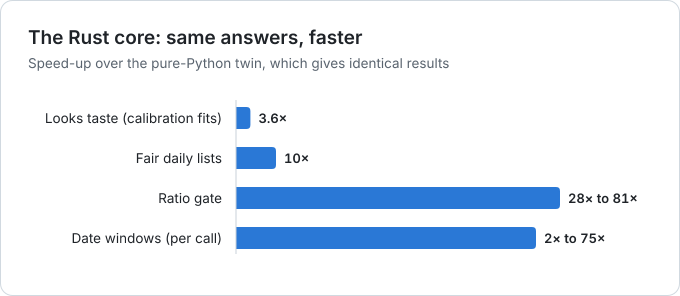
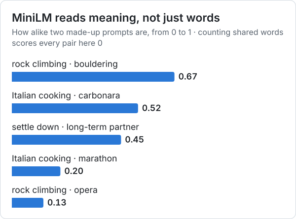

<p align="center">
  
</p>

<p align="center">
  <a href="https://github.com/currencycaver29/lastfirstdate-matching/actions/workflows/checks.yml"></a>
  <a href="https://github.com/currencycaver29/lastfirstdate-matching/releases"></a>
  
  
  
  
  
</p>

<p align="center">
  <a href="#how-it-works"><b>How it works</b></a> ·
  <a href="#quick-start"><b>Quick start</b></a> ·
  <a href="#results"><b>Results</b></a> ·
  <a href="#for-the-app-developer"><b>For the app developer</b></a> ·
  <a href="#documentation"><b>Docs</b></a> ·
  <a href="#roadmap"><b>Roadmap</b></a>
</p>

---

## About

[lastfirstdate](https://lastfirstdate.vercel.app/) is a verified dating service for New York.
This repository is its matching engine: it decides who sees whom, and when and where they meet.
Matches are ranked half on looks, as each member sees them, and half on personality, and only
pairs who suit each other are suggested. The app itself is built separately and calls the
engine through one module, [`lastfirstdate.app`](src/lastfirstdate/app.py).

## At a glance

<table>
  <tr>
    <td width="50%" valign="top">
      <h4>Learns each member's own taste</h4>
      About 30 photo questions train a personal looks model on top of Google SigLIP. There is
      no global attractiveness score, ever.
    </td>
    <td width="50%" valign="top">
      <h4>Mutual by design</h4>
      50% looks and 50% personality, scored in both directions. A pair ranks high only when
      both people would say yes.
    </td>
  </tr>
  <tr>
    <td valign="top">
      <h4>Fair attention</h4>
      Daily lists share exposure under a cap, so a few popular profiles can't take it all, with
      a boost for members still owed dates.
    </td>
    <td valign="top">
      <h4>Real dates, not just matches</h4>
      Every profile comes with a time both can make, a 15-minute payment hold, and a venue fair
      to both.
    </td>
  </tr>
  <tr>
    <td valign="top">
      <h4>Protects the promise</h4>
      Forecasts each man's chance of three dates a month and pauses sales when the zone can't
      serve more.
    </td>
    <td valign="top">
      <h4>Fast, tested, reproducible</h4>
      A Rust core for the hot loops (up to 81× faster), a test for every one of 62
      requirements, and every model file pinned by fingerprint.
    </td>
  </tr>
</table>

## How it works



Blue boxes are the matching stages a profile passes through every day. After each date, the
green boxes learn from what happened and the orange box keeps the promise of three dates a
month; all three shape the next day's lists.

<details>
<summary><b>What each stage does</b></summary>

<br/>

| # | Stage | What it does |
|:-:|---|---|
| 1 | **Filter** | Keeps only pairs who could actually meet: orientation both ways, age, distance, dealbreakers, verification |
| 2 | **Calibration** | Picks about 30 photos, singles and "who are you more drawn to?" pairs, that teach the model the most about a new member |
| 3 | **Looks taste** | Learns each member's personal photo taste as a small Bayesian model on top of a shared starting point |
| 4 | **Personality** | Scores free-text prompts, intent answers (timeline, exclusivity, kids) and interests |
| 5 | **Mutual score** | Mixes looks and personality 50/50 in each direction, then combines both directions so both people must want it |
| 6 | **Daily lists** | Builds each woman's daily list under an exposure cap, with a boost for men still owed dates |
| 7 | **Booking** | Proposes the earliest window both are free, holds it for 15 minutes while both $10 payments arrive, picks a venue fair to both |
| 8 | **Learning** | Learns from picks, dates and private ratings, and keeps exploring a little |
| – | **Trust** | Builds a private score from respectfulness, profile accuracy and showing up; lowers low-trust profiles and flags them for review |
| – | **Guarantee** | Forecasts each man's chance of three dates, admits men from the waitlist only while that holds, counts delivered dates and credits shortfalls |

</details>

### The engine and the test harness

| | The engine | The test harness |
|---|---|---|
| **What it is** | The product: filter, tastes, scores, lists, booking, billing, trust, forecast | Synthetic members who pick, accept, show up and rate |
| **In production** | Yes: the app calls [`lastfirstdate.app`](src/lastfirstdate/app.py) | Never |
| **Hidden "true" tastes** | Never reads them (a test enforces it) | Reads them, to grade the engine |

## Results

Ten fresh synthetic New York zones, run through the whole engine for three billing cycles each.
Every member has hidden "true" tastes the engine never reads, so it can be graded honestly.
These numbers compare designs; they are not predictions. Reproduce them with
`python -m lastfirstdate.nyc_report`.

<p>
<picture>
  <source media="(prefers-color-scheme: dark)" srcset="docs/assets/charts/promise-dark.svg">
  
</picture>
</p>

<p>
<picture>
  <source media="(prefers-color-scheme: dark)" srcset="docs/assets/charts/ordering-dark.svg">
  
</picture>
</p>

<p>
<picture>
  <source media="(prefers-color-scheme: dark)" srcset="docs/assets/charts/outcomes-dark.svg">
  
</picture>
</p>

<details>
<summary><b>The numbers behind the charts</b></summary>

<br/>

| Measure | 300 women · 100 men | 500 women · 167 men |
|---|---:|---:|
| Men with 3 delivered dates, all cycles | 77% (70% to 85%) | 91% (86% to 93%) |
| The engine's forecast before launch | 74% | 87% |
| Credits, as a share of subscriptions | 15% | 6% |
| Looks model ranks truly preferred faces higher | 93% of the time | 93% of the time |
| Top 10, chance both say yes (mutual ordering) | 20.4% | 23.3% |
| Women with no date in a 28-day period | 52% | 48% |
| Bad actors caught after 6+ ratings | 40 of 40 | 57 of 60 |
| Members wrongly flagged | 0 | 1 |

The looks score is flattering: in the test harness, taste is a straight line in the photo
vectors, like the model. Each sprint's notes in [`docs/sprints/`](docs/sprints/) explain the
results and their limits.

</details>

<details>
<summary><b>Abuse testing: what synthetic attackers gained</b></summary>

<br/>

Sprint 14 added attackers to the test runs (`python -m lastfirstdate.attacks`, three zones of
300 women and 100 men). Every attack that gained anything got a defence and a test.

| Attack | Without the defence | With it |
|---|---|---|
| Prompt stuffed with words everyone writes | 67th percentile of women's personality rankings (honest: 49th) | 45th: prompts are compared without the zone's average |
| One account flooding the photo exercise | target man up from 0.47 to 0.52 in women's looks rankings | 0.47: one account, one exercise |
| 30 fake women (10%) steering the starting taste | target up to 0.54 | 0.47 if they can't pass identity checks; verified fakes are the limit |
| 50 fake women counted by the ratio gate | 6.7 places sold instead of 3; 3-date share 83% instead of 94% | after 4 weeks of lists, 83% of fakes no longer count (0.6% of real women) |
| Forged ratings, malformed booking rows | counted toward trust, or crashed the daily lists | ignored, or refused with the booking named |
| 20 spy accounts reading their lists for a ranking | correlation with consensus looks 0.04 (0.14 with the exposure cap off) | already blocked by the exposure cap; a test keeps it so |

Rating rings remain the owner's call: 3 colluding women got a target paused in 5 of 24 tries.
Details in [`docs/sprints/sprint-14.md`](docs/sprints/sprint-14.md).

</details>

## Quick start

**Requirements:** Python 3.11 or newer, and Rust from [rustup.rs](https://rustup.rs) (installing
the package compiles the Rust core).

```bash
git clone https://github.com/currencycaver29/lastfirstdate-matching.git
cd lastfirstdate-matching
python -m venv .venv
.venv/bin/pip install -e ".[dev]"
./scripts/check.sh                      # Rust and Python lint, tests, traceability
```

On Windows, use `.venv\Scripts\pip` instead of `.venv/bin/pip`.

**Try it** on 1,000 synthetic New Yorkers:

```python
from lastfirstdate.config import load
from lastfirstdate.synthetic import generate
from lastfirstdate.month_runs import run_month

cfg = load()                   # research defaults; load("config/phase1.toml") for Phase 1 rules
pop = generate(cfg, seed=7)    # 1,000 synthetic New Yorkers
report = run_month(pop, cfg)
print(report.text())
```

**Production models** (Google SigLIP for photos, MiniLM for prompts) run on a normal CPU; every
file is checked against a pinned fingerprint:

```bash
.venv/bin/pip install -e ".[models]"
.venv/bin/python -m lastfirstdate.encoders download
```

<details>
<summary><b>All reports</b></summary>

<br/>

Each report runs on synthetic members and prints what it found:

```bash
.venv/bin/python -m lastfirstdate.month_runs        # one test month
.venv/bin/python -m lastfirstdate.looks_report      # how well the looks model learns taste
.venv/bin/python -m lastfirstdate.mutual_report     # list rankings compared
.venv/bin/python -m lastfirstdate.fairness_report   # exposure, fairness audit, hold-back test
.venv/bin/python -m lastfirstdate.learning_report   # three months with and without learning
.venv/bin/python -m lastfirstdate.phase1_report     # Phase 1 rules: pair questions, the ratio gate
.venv/bin/python -m lastfirstdate.cycle_runs        # the real booking flow over three billing cycles
.venv/bin/python -m lastfirstdate.gate_report       # the ratio gate in the real flow, two zone sizes
.venv/bin/python -m lastfirstdate.fixes_report      # the Sprint 12 fixes, measured
.venv/bin/python -m lastfirstdate.models_report     # the real photo and text models (needs .[models])
.venv/bin/python -m lastfirstdate.nyc_report        # the NYC demo: ten zones, start to finish
.venv/bin/python -m lastfirstdate.attacks           # synthetic attackers and what each gains
```

To refit the guarantee forecast after changing the settings, run
`python -m lastfirstdate.forecast_fit --delivered` (about 16 minutes).

</details>

## For the app developer

- **One module:** the app calls [`lastfirstdate.app`](src/lastfirstdate/app.py) and nothing
  else. It reads the app's database and returns decisions; it never writes or talks to members.
- **When to call what:** the [handoff guide](docs/handoff/README.md) lists every call (sign-up,
  photo exercise, nightly refresh, daily lists, picks, bookings, cycle end, the gate) with what
  it reads and returns.
- **The database:** [`db/schema.sql`](db/schema.sql) runs on PostgreSQL and SQLite.
- **Build against a release,** not `main`: [releases](https://github.com/currencycaver29/lastfirstdate-matching/releases).

## Tech stack

| Layer | Built with | Why |
|---|---|---|
| **Engine** |    | Clear, testable maths for every stage |
| **Scheduling** |  | Exact assignment of dates to weekly slots |
| **Hot loops** |   | Up to 81× faster, with a Python twin giving identical answers |
| **Models** |    | Real photo and text models on a normal CPU |
| **Data** |   | SQLite in tests, PostgreSQL in production, one schema |
| **Quality** |    | Every check on every push |

### Under the hood

<p>
<picture>
  <source media="(prefers-color-scheme: dark)" srcset="docs/assets/charts/speed-dark.svg">
  
</picture>
</p>

<p>
<picture>
  <source media="(prefers-color-scheme: dark)" srcset="docs/assets/charts/prompts-dark.svg">
  
</picture>
</p>

<sub>Banner and charts are drawn by [`scripts/readme_art.py`](scripts/readme_art.py) in
[Inter](https://rsms.me/inter/) (SIL Open Font License), from the numbers above.</sub>

## Configuration

Every weight, cap and threshold lives in a settings file, never in code:

| File | Use |
|---|---|
| [`config/lastfirstdate.toml`](config/lastfirstdate.toml) | Research defaults: a 1,000-member city, every orientation |
| [`config/phase1.toml`](config/phase1.toml) | lastfirstdate's Phase 1: one NYC zone, 100 paying men and 300 women, a three-date cap, 30 calibration photos |

`LASTFIRSTDATE_BACKEND=python` runs everything in plain Python instead of Rust. The answers
are the same, only slower.

## Project structure

<details>
<summary><b>Show the tree</b></summary>

<br/>

```
lastfirstdate-matching/
├── config/              settings files and the fitted forecast
├── db/schema.sql        the database the app should keep
├── docs/                specification, research, sprint notes, fit report, risk plan, handoff
├── rust/
│   ├── lastfirstdate-core/   the hot loops in pure Rust
│   └── lastfirstdate-py/     Python bindings (lastfirstdate._core)
├── src/lastfirstdate/   the engine (Python; app.py is what the app calls) and the test harness
├── tests/               one or more tests per requirement
├── workspace/           a map of every algorithm stage, for working with an AI assistant
└── scripts/check.sh     all the checks
```

</details>

## Principles

These rules are never broken, and tests enforce them:

1. **Mutual orientation lock.** Someone is shown to you only if each of you is a gender the
   other is looking for.
2. **No global attractiveness score.** Looks are only ever scored from one member's own point
   of view. Nothing ranks people by overall attractiveness.
3. **Synthetic data only** in this repository. In production, photo embeddings are treated as
   biometric data: encrypted, kept apart, deleted when a member leaves.
4. **Tests run offline,** with no model downloads.
5. **Every tunable number lives in the settings files.**
6. **Dealbreakers are hard filters,** never soft penalties.
7. **Same seed, same result.** All randomness is seeded.

## Documentation

| Document | What's in it |
|---|---|
| [Specification](docs/SPEC.md) | Every requirement, rule and decision, and how the plan changed |
| [Research map](docs/research.md) | The 17 papers and where each one is used |
| [Sprint notes](docs/sprints/) | In-depth study notes for every sprint, with results and limits |
| [Fit report](docs/fit-report.md) | The engine checked against lastfirstdate's website |
| [Risk plan](docs/risk-plan.md) | What to do before launch, including a ready-to-send lawyer briefing |
| [Handoff](docs/handoff/README.md) | For the app developer: which engine call happens when, what it reads and returns |
| [Workspace](workspace/CONTEXT.md) | A one-page map of each algorithm stage and how sprints are run (Interpretable Context Methodology), so an AI assistant reads only the part it works on |

## Roadmap

| Sprint | Focus | Status |
|:-:|---|---|
| 0 | Foundation: settings, member model, synthetic city, checks |  |
| 1 | A working matcher on personality alone |  |
| 2 | The looks model and the photo exercise |  |
| 3 | The 50/50 mutual score |  |
| 4 | Fair daily lists |  |
| 5 | Learning from dates |  |
| 6 | lastfirstdate's real rules, the guarantee forecast and the ratio gate |  |
| – | The Rust core for the hot loops |  |
| 7 | Booking, billing, trust, geography and the app's database |  |
| 8 | The forecast and the gate on delivered dates |  |
| 9 | Handoff to the app: the engine on the app's database, and the call sequence |  |
| 10 | Step-by-step photo exercise and a nightly cache |  |
| 11 | Ready for real data: outcomes from the app's records, recalibration, when to switch |  |
| 12 | Bug fixes before Phase 1: New York time, picks checked again, blocks, forgetting a member, list positions |  |
| 13 | The real models: Google SigLIP for photos and MiniLM for prompts, pinned and checked |  |
| 14 | Abuse testing: synthetic attackers, and a defence and a test for every attack that gained |  |
| 15 | The code review findings: a crash fixed, photos upright, a tighter cache, times with their zone, faster pick checks |  |
| 16 | A consented pilot to recheck the photo settings, then real Phase 1 data and monthly recalibration |  |

## Releases

Each pushed sprint is tagged as a release, numbered major.minor.fix: the major number changes
when the app must change how it calls the engine, the minor number with each sprint, and the
fix number for bug fixes. Build the app against a release, not against `main`. The current
release is **v0.15.0** (Sprint 15's fixes for the code review findings);
v1.0.0 is planned for the Phase 1 launch.

## License

Proprietary: all rights reserved by currencycaver29. See [`LICENSE`](LICENSE). The libraries it
builds on (NumPy, SciPy, OR-Tools, PyO3, rust-numpy, ONNX Runtime) keep their own permissive
licences, and both models are Apache 2.0.

<p align="center"><sub>The matching engine behind <a href="https://lastfirstdate.vercel.app/">lastfirstdate</a>, New York.</sub></p>
